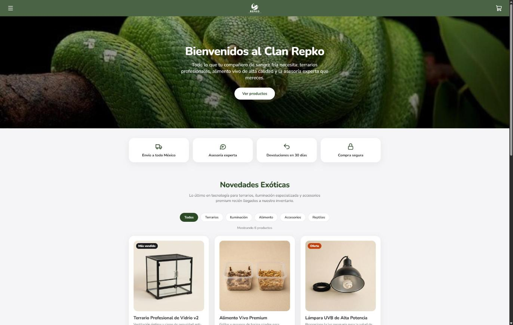
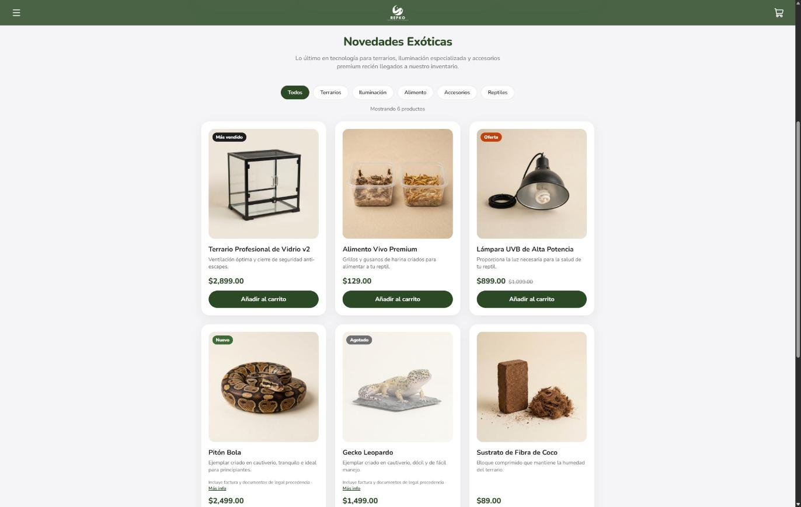
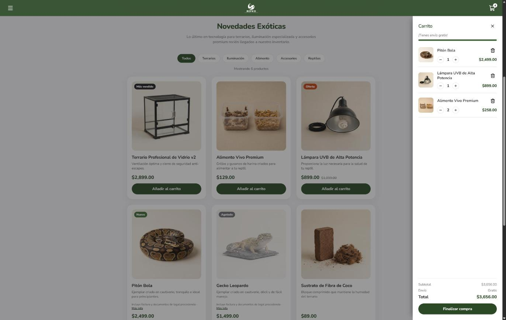
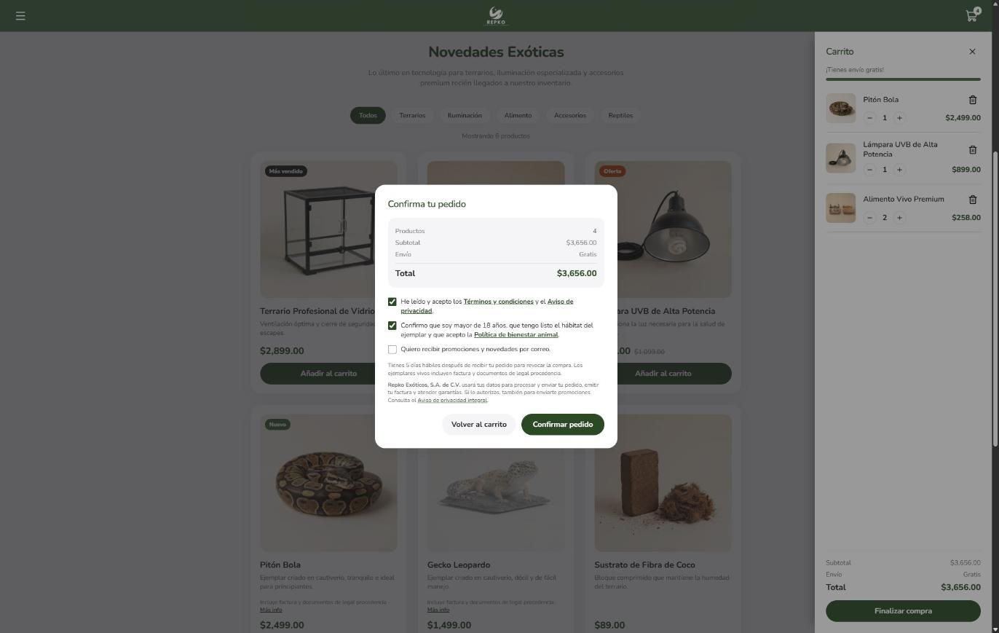
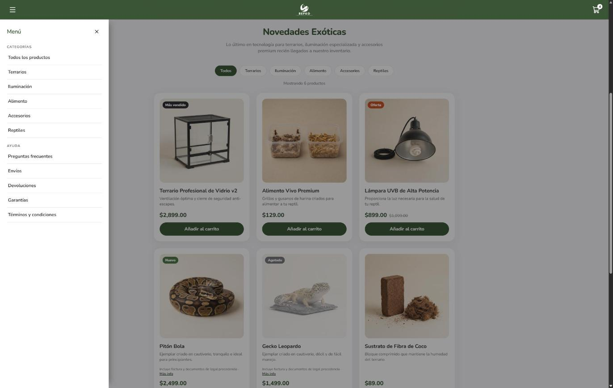
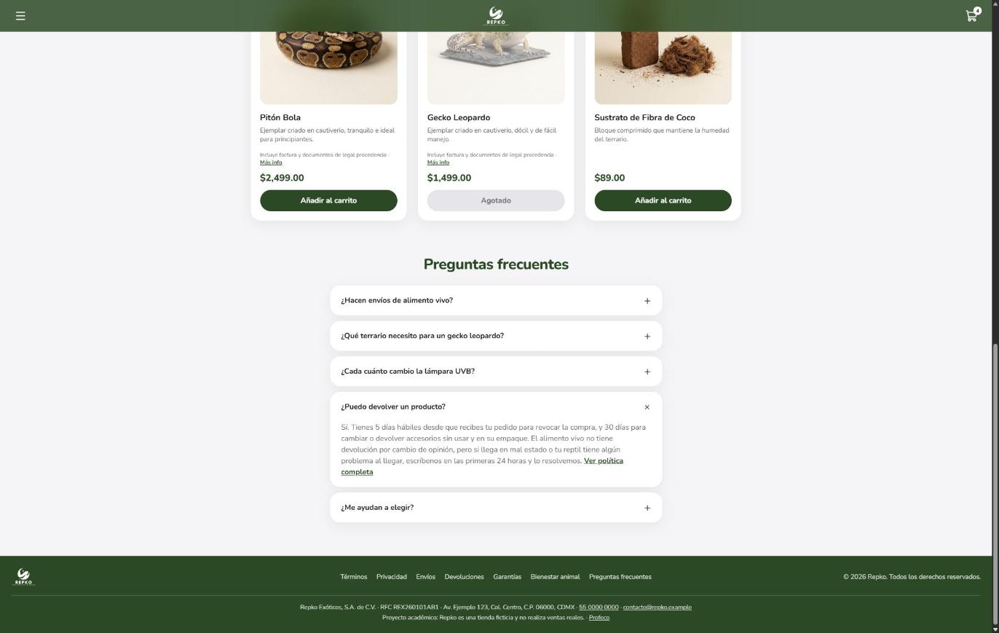
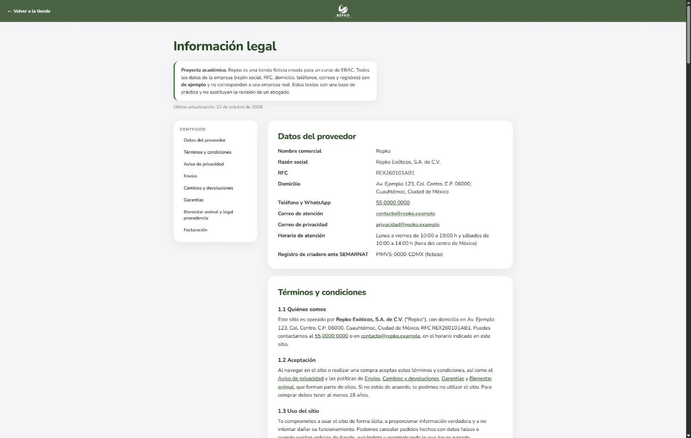

# Repko 🦎

Repko es una tienda en línea de reptiles y todo lo que necesitan: terrarios, lámparas, alimento vivo, accesorios y algunos ejemplares. La hice como proyecto del curso **Desarrollo Front End de cero a pro de EBAC**.

> **Ojo:** es una tienda ficticia. No vende nada de verdad, no cobra y los datos de la empresa son de ejemplo.

- 🌐 **Ver la página en línea:** https://lemond01.github.io/reptiles_ecommerce/
- 📁 **Repositorio:** https://github.com/Lemond01/reptiles_ecommerce



## ¿Qué puedes hacer en la página?

- **Ver los productos** y filtrarlos por categoría: terrarios, iluminación, alimento, accesorios y reptiles.
- **Distinguir las etiquetas** de cada producto: nuevo, más vendido, en oferta (con el precio anterior tachado) o agotado.
- **Armar tu carrito:** sumar o quitar piezas, borrar productos y ver cuánto te falta para el envío gratis. El carrito se queda guardado aunque cierres la página.
- **"Finalizar" la compra** en una ventana donde confirmas tu pedido y aceptas los términos. Si llevas un reptil, también confirmas que eres mayor de edad y que ya tienes listo su hábitat.
- **Navegar con el menú lateral,** que te lleva a cada categoría y a las secciones de ayuda.
- **Leer las preguntas frecuentes** y toda la **información legal:** términos, privacidad, envíos, devoluciones, garantías y bienestar animal.

## Así se ve

### Productos
Cada producto tiene su foto, su precio y su etiqueta. Los filtros de arriba muestran solo la categoría que eliges.



### Carrito
El carrito sale por la derecha y muestra el subtotal, el envío y el total.



### Confirmar el pedido
Antes de terminar, una ventana te muestra el resumen y te pide aceptar los términos.



### Menú
El menú sale por la izquierda, con las categorías y los enlaces de ayuda.



### Preguntas frecuentes
Las dudas más comunes, en tarjetas que se abren y se cierran.



### Información legal
Una página aparte con todas las políticas de la tienda y un índice para saltar a cada una.



## ¿Cómo la veo?

La forma más fácil es abrir el [enlace de la página en línea](https://lemond01.github.io/reptiles_ecommerce/).

Si prefieres verla en tu computadora:

1. Descarga o clona este repositorio.
2. Abre el archivo `index.html` en tu navegador.

¡Y listo! No hace falta instalar nada. La página también se adapta a tablet y celular.

## ¿Quieres cambiar los estilos?

Los estilos se escriben en `scss/styles.scss` y se convierten en `css/styles.css`, que es el archivo que usa la página. No edites `css/styles.css` a mano: se vuelve a crear cada vez que compilas.

Puedes compilar de dos formas:

- **Con Visual Studio Code:** instala la extensión **Live Sass Compiler** y pulsa **Watch Sass** en la barra de abajo. Configúrala para que guarde el resultado en la carpeta `css/`.
- **Desde la terminal:** necesitas tener [Node.js](https://nodejs.org/) instalado. Instala Sass una sola vez:

  ```
  npm install -g sass
  ```

  Y después, desde la carpeta del proyecto:

  ```
  sass --watch --no-source-map scss/styles.scss css/styles.css
  ```

  Con `--watch`, el CSS se actualiza solo cada vez que guardas el archivo `.scss`. Para detenerlo, pulsa `Ctrl + C`.

## ¿Con qué está hecha?

- **HTML** para el contenido de la página.
- **Sass**, una forma más ordenada de escribir los estilos (colores, tamaños y diseño), que luego se convierte en CSS.
- **JavaScript** para que todo funcione: el carrito, los filtros, el menú y las ventanas.

Todo está hecho a mano, sin plantillas ni librerías.
